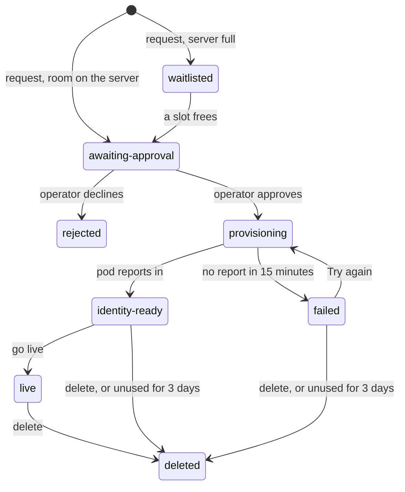

A pod is a hosted copy of your agent that co-signs and locks trades for your ads. One pod can serve up to 16 ads that
share a chain, an agent account and a settlement signer. These endpoints take a pod from request to live: you request
it, follow it through approval, choose the ads it serves, register its key, file its retirements, and go live. See [Agents](/v3/concepts/agents) for what an agent may do.

<Note>
A pod request needs a ProofBridge operator's approval before anything runs. Only makers may request a pod: you need at
least one ad that is `ACTIVE`, `PAUSED` or `EXHAUSTED`, created from your wallet or a [linked account](/v3/api/accounts).
Each maker may have up to 2 pods by default, counting every pod that is not rejected or deleted.
</Note>

## Endpoints

| Endpoint | Auth | Purpose |
| --- | --- | --- |
| `POST /v1/pods` | user | request a pod, or try again after a failed start |
| `POST /v1/pods/rpc-check` | user | check RPC endpoints before you send them |
| `GET /v1/pods` | user | list your pods |
| `GET /v1/pods/capacity` | user | room on the pod server, and whether you may request |
| `GET /v1/pods/:id` | user | one pod's status and next step |
| `GET /v1/pods/:id/eligible-ads` | user | the ads this pod can serve |
| `GET /v1/pods/:id/registration` | user | the pod's key registration, ready for you to sign |
| `POST /v1/pods/:id/registration/rotate` | user | ask the pod for a new key |
| `POST /v1/pods/:id/ad` | user | make one ad the pod's only ad |
| `POST /v1/pods/:id/ads` | user | add an ad to the pod |
| `DELETE /v1/pods/:id/ads/:adId` | user | take an ad out of the pod |
| `PATCH /v1/pods/:id/rpc` | user | update the pod's RPC endpoints |
| `POST /v1/pods/:id/go-live` | user | take the pod out of dry run |
| `POST /v1/pods/:id/gas-withdrawal` | user | send the gas left in the pod's accounts back to your wallets |
| `DELETE /v1/pods/:id` | user | delete the pod |
| `GET /v1/pods/:id/logs` | user | stream the pod's logs (server-sent events) |

Every pod route acts only on your own pods. Another user's pod answers `403 not-owner`, an unknown id `404 not-found`.
Pod refusals are coded: branch on `error`, never on `message`. Some carry an extra field such as `limit`, `field`,
`fields`, `chains`, `chainIds` or `status`. Times in pod bodies are unix seconds unless a field says ISO 8601.

```json
{ "error": "pod-limit", "message": "You can run 2 pods. Delete one to make room.", "limit": 2 }
```

## Status and next step

A pod has a `status`, where it is in its life, and a `nextStep`, what you should do now. Drive the screen from
`nextStep`; use `status` for badges and filters.

| Status | Meaning |
| --- | --- |
| `awaiting-approval` | the request is under review by an operator; nothing runs yet. An approved request waiting for its deploy turn also stays here |
| `waitlisted` | the pod server is full; `waitlistPosition` is your place in line |
| `rejected` | an operator declined the request; `decisionReason` says why. The label is free for a new request |
| `provisioning` | approved and starting |
| `failed` | the approved start failed, or the pod did not report within 15 minutes; `error` says which. Use **Try again** |
| `identity-ready` | the pod is running and has reported its addresses and key |
| `retirements-filed` | `identity-ready` with every retirement on file; ready to go live |
| `live` | trading within its policy |
| `deleted` | deleted; never listed. `decisionReason` says by whom |

| `nextStep` | What to do |
| --- | --- |
| `awaiting-approval` | wait for an operator to approve; keep polling |
| `waitlisted` | show `waitlistPosition`; keep polling |
| `wait` | the pod is starting, or a check is still running; keep polling |
| `set-rpc` | add both RPC endpoints with `PATCH /v1/pods/:id/rpc`; the pod cannot start without them |
| `choose-ad` | pick an ad from `GET /v1/pods/:id/eligible-ads` and send it to `POST /v1/pods/:id/ad` or `POST /v1/pods/:id/ads` |
| `no-custody` | the pod's ad is a plain wallet's, not an [agent account](/v3/api/accounts)'s, so the chain would refuse the pod's locks; move the ad to your agent account, or choose one made from it. This applies on Stellar and on an EVM chain where the agent module is set up |
| `set-policy` | the agent account holds no live policy for the pod's key (none, expired, or naming another signer), or the live policy leaves out one of the pod's ads (`adsNotInPolicy`); sign one from your wallet, on chain |
| `agent-revoked` | the agent account revoked the pod's key for good; delete the pod and request a new one |
| `register-key` | register the pod's key: [see below](#register-the-pods-key) |
| `awaiting-binding` | the registration is in flight; keep polling |
| `file-retirements` | file a pre-signed retirement for each chain in `coverage.gaps` |
| `fund-gas` | top up the pod's operational accounts from your wallet; the pod pays the fee for every lock from them |
| `go-live` | everything is in place; call `POST /v1/pods/:id/go-live` |
| `none` | no step: the pod is live, or `failed` (offer **Try again**), `rejected` or `deleted` |

A live pod can also show `set-policy` when its policy expires, or `agent-revoked` once you revoke it. Offer **Delete**
on every pod except a deleted one.

### The state machine in brief



`rejected` and `deleted` are final; their label is free for a new request with a new `id`. A pod that is
`identity-ready` or `failed` and unused for 3 days is reclaimed. A live pod is never reclaimed. `retirements-filed` is
computed on read from `identity-ready`.

## The pod object

`GET /v1/pods/:id` and every pod write except create answer with this body.

```json
{
  "id": "3f9c2b1e-7a4d-4c1b-9f0e-2d6a8b5c4e71",
  "label": "Example Fund",
  "status": "identity-ready",
  "nextStep": "register-key",
  "error": null,                  // failed: why
  "decisionReason": null,         // rejected or deleted: why
  "contact": null,                // failed: the approved contact, for Try again (your own session only)
  "updatedAt": "2026-09-28T00:10:00.000Z",  // ISO 8601: when the pod last changed
  "startLate": false,             // true: a starting pod has been quiet longer than expected
  "waitlistPosition": null,       // from 1, only while waitlisted
  "adId": "6d1e8a20-4b7c-4f3a-a1d2-9c0b7e5f3a18",  // the pod's first ad
  "adIds": ["6d1e8a20-4b7c-4f3a-a1d2-9c0b7e5f3a18"],  // every ad the pod serves, oldest first
  "openTradeAdIds": [],           // ads outside the pod with an open trade the pod still settles
  "adsNotInPolicy": [],           // the pod's ads the live policy doesn't name yet; null while unreadable
  "adsOnlyInPolicy": [],          // ads the policy names that the pod no longer serves; null while unreadable
  "policyEveryAd": false,         // the policy names every ad of the account; null while unreadable
  "custodyAd": true,              // setup will ask for an agent policy; null with no ad or a failed read
  "manifest": {
    "plan": "pilot",
    "channel": "production",
    "imageRef": "ghcr.io/…@sha256:…",   // null until deployed
    "rpcOwnership": "manifest",
    "registryChainIds": ["11155111", "1000002"],
    "rpcSet": { "evm": true, "stellar": true },       // which endpoints are on record; never the URLs
    "rpcPublic": { "evm": false, "stellar": false }   // true: a shared public RPC; warn the user
  },
  "identity": {                   // null until the pod reports
    "evmAddress": "0x7e5f4552091a69125d5dfcb7b8c2659029395bdf",
    "stellarAccount": "GBRPYHIL2CI3FNQ4BXLFMNDLFJUNPU2HY3ZMFSHONUCEOASW7QC7OX2H",
    "blsPubKey": "0xa1a1…a1",     // the pod's identity proof; never the key that gets registered
    "reportedAt": 1790000000
  },
  "heartbeat": {                  // null until the first heartbeat
    "at": 1790000060,
    "imageDigest": "sha256:…",
    "dryRun": true,               // false on the first heartbeat after go-live
    "lastEvmRead": 1790000055,
    "lastStellarRead": 1790000058,
    "lastCosign": null,
    "keyVolume": true,
    "uptimeS": 620,
    "features": ["gas-withdrawal"], // what the pod's runtime said it can do
    "owners": [                   // the owner wallets the pod's configuration names
      { "account": "0x0000…beddc4", "keyCommitment": "0xe5e5…e5" }
    ]
  },
  "coverage": { "scanned": true, "gaps": [ { "chainId": "1000002", "slotId": 0, "detail": "…" } ] },
  "agentKey": {                   // null until the pod posts its registration request
    "settlementIdentity": "0x5b38da6a701c568545dcfcb03fcb875f56beddc4",  // the account the key registers under
    "blsPubKey": "0xa1a1…a1",     // the key the pod co-signs with
    "keyCommitment": "0xd4d4…d4", // name it in the pod's retirement
    "keyIndex": 0
  },
  "gas": {                        // null until the pod reports
    "evm": { "address": "0x7e5f…5bdf", "chainId": "11155111", "balance": "0.03", "minimum": "0.01",
             "suggested": "0.05", "symbol": "ETH", "level": "top-up-soon", "readAt": 1790000060 },
    "stellar": { "address": "GBRP…OX2H", "balance": "0", "minimum": "5", "suggested": "20",
                 "symbol": "XLM", "level": "missing", "readAt": 1790000060 }
  },
  "gasWithdrawal": null           // the latest gas withdrawal you asked for; see below
}
```

- `gas.*.level` is `ok`, `top-up-soon`, `low`, `missing` (a Stellar account not yet on chain) or `unknown` (the read
  failed; `balance` is null). Balances are in whole coins and cached for 30 seconds; add `?fresh=1` right after a
  top-up. Send an EVM top-up on `gas.evm.chainId`.
- `coverage` is null before the pod reports and while the check cannot run. `scanned: false` means it has not run yet.
- `adsNotInPolicy`, `adsOnlyInPolicy` and `policyEveryAd` compare the pod's ads with the agent account's live policy.
  When `adsNotInPolicy` is not empty, re-sign the policy with those ads.
- `openTradeAdIds` lists ads you took out of the pod that still have open trades on its key. The pod keeps settling
  them.

## Request a pod

`POST /v1/pods`

Sends a request for review. Nothing is deployed until an operator approves it. If the pod server is full, the request
is `waitlisted` instead, with no error. This route has a strict per-IP rate limit.

```json
{
  "label": "Example Fund",          // 1 to 80 chars, one line, at least one letter or digit
  "contact": "ops@example.com",     // an email address, at most 200 chars
  "plan": "pilot",                  // the only plan
  "registryChainIds": ["11155111", "1000002"],  // chains the pod's key is registered on
  "rpcOwnership": "manifest",       // optional: "manifest" (default) or "tenant-held"
  "rpc": {                          // optional at request time
    "evmUrl": "https://eth-sepolia.your-provider.example",
    "evmUrl2": "https://eth-sepolia.other-provider.example",  // optional second provider
    "stellarUrl": "https://soroban.your-provider.example",
    "stellarUrl2": null
  }
}
```

```json
{ "id": "3f9c2b1e-7a4d-4c1b-9f0e-2d6a8b5c4e71", "status": "awaiting-approval", "nextStep": "awaiting-approval", "waitlistPosition": null }
```

- `rpcOwnership: "manifest"` keeps the endpoints with the pod's configuration, so it restores itself after a host loss.
  `"tenant-held"` leaves them with you, and the pod stays down after a host loss until you enter them again.
- Under `"manifest"`, both `evmUrl` and `stellarUrl` must be on record before the pod can start; `nextStep: "set-rpc"`
  tells you when.
- Every URL must be a public `https` provider endpoint with a real hostname: no IP literals, `localhost`, `.internal`
  or `.local`. The endpoints are stored encrypted and never returned.
- One open pod per label. A rejected or deleted pod's label is free again.

**Try again.** For a `failed` pod that was approved, send `POST /v1/pods` again with the same `label`. The pod is
redeployed with the same `id` and no new review, and the answer is `status: "provisioning"`. You may change `rpc` and
`rpcOwnership`; `contact`, `plan` and `registryChainIds` must stay as approved.

| Status | Error | When |
| --- | --- | --- |
| `400` | `rpc-invalid` | an endpoint fails the rules; `field` names it |
| `400` | `rpc-not-tenant-owned` | the endpoint belongs to ProofBridge; use your own provider |
| `400` | `rpc-shared-key` | two endpoints share one provider key; `fields` names them |
| `400` | `rpc-same-provider` | both endpoints for a chain use the same provider |
| `400` | `invalid-label`, `invalid-contact` | bad label or contact |
| `500` | `manifest-invalid` | the relayer could not prepare the request; a fault on ProofBridge's side, not in what you sent. Try again later |
| `400` | `plane-refused` | the pod host refused the configuration |
| `403` | `maker-required` | you have no `ACTIVE`, `PAUSED` or `EXHAUSTED` ad |
| `409` | `pod-exists` | you already have a pod with this label |
| `409` | `pod-limit` | you are at your cap; `limit` says what it is |
| `409` | `retry-differs` | a Try again changed `contact`, `plan` or `registryChainIds`; `fields` names them |
| `409` | `pod-changed` | the pod changed meanwhile; reload and retry |
| `502` | `plane-unavailable` | the pod host is not reachable; nothing was created |
| `503` | `plane-busy` | the pod host is busy; try again in a minute |
| `503` | `requests-paused` | the review queue is full; try again later |
| `503` | `pods-not-configured` | pod hosting is not set up on this relayer |

## Check endpoints

`POST /v1/pods/rpc-check` asks the relayer to try your endpoints before you send them. It takes any of `evmUrl`,
`evmUrl2`, `stellarUrl` and `stellarUrl2` and answers one result per endpoint sent. It is advice only: a request is
never refused because of it. This route has a strict per-IP rate limit.

```json
{
  "results": [
    { "field": "evmUrl", "status": "ok", "message": "This endpoint answered on the right network." },
    { "field": "stellarUrl", "status": "wrong-network", "message": "This endpoint answered, but on a different network from the one ProofBridge uses here." }
  ]
}
```

| `status` | Meaning |
| --- | --- |
| `ok` | it answered on the network ProofBridge uses here |
| `wrong-network` | it answered, on another network |
| `unreachable` | it did not answer |
| `refused` | not checked: it must be an `https` hostname on the public internet |

| Status | Error | When |
| --- | --- | --- |
| `503` | `rpc-check-busy` | too many checks are running; try again shortly, or carry on without one |

## List and capacity

`GET /v1/pods` lists your pods, newest first. Deleted pods are left out; rejected requests stay listed. The list has
no `nextStep`; open the pod for that.

```json
{ "pods": [ { "id": "3f9c2b1e-7a4d-4c1b-9f0e-2d6a8b5c4e71", "label": "Example Fund", "status": "live", "plan": "pilot", "createdAt": "2026-09-28T00:00:00.000Z" } ] }
```

`GET /v1/pods/capacity` tells you whether to show the request form. Read it first, so you never show a form the
relayer would refuse.

```json
{ "state": "almost-full", "canRequest": "yes" }
```

| Field | Value | Meaning |
| --- | --- | --- |
| `state` | `open`, `almost-full`, `full` | room on the pod server; `almost-full` is 80% or more in use, `full` means a new request is waitlisted |
| `canRequest` | `yes` | show the form |
| | `no-ad` | you have no qualifying ad; link to creating one instead |
| | `paused` | the review queue is full; show the form disabled |

The request route still checks both, so map `maker-required` and `requests-paused` on submit too. If the pod host
cannot be reached, this answers `502 plane-unavailable` or `503 plane-busy`.

## One pod

`GET /v1/pods/:id` returns [the pod object](#the-pod-object). Poll it to follow the pod; render your call to action
from `nextStep`.

## Choose the ads

`GET /v1/pods/:id/eligible-ads` lists your ads the pod can serve: `ACTIVE`, `PAUSED` or `EXHAUSTED`, oldest first.

```json
{
  "ads": [
    {
      "id": "6d1e8a20-4b7c-4f3a-a1d2-9c0b7e5f3a18",
      "chainId": "11155111",
      "chainKind": "EVM",
      "creatorAddress": "0x5b38da6a701c568545dcfcb03fcb875f56beddc4",
      "creatorKind": "WALLET",       // "WALLET" | "STELLAR_AGENT_ACCOUNT" | "EVM_CUSTODY_ACCOUNT"
      "settlementSigner": "0x5b38da6a701c568545dcfcb03fcb875f56beddc4",  // the account the pod's key registers under
      "status": "ACTIVE",
      "chosen": true,                // the pod serves this ad now (the same as inPod)
      "inPod": true,
      "notGroupable": null           // why it can't join the pod's ads; null when it can
    }
  ]
}
```

A pod's ads share one chain, one agent account, one settlement signer, one ad token and one order token, so one policy
covers them all. `notGroupable` names the first that differs: `chain`, `account`, `signer`, `token` or `orderToken`,
or `full` when the pod already serves 16 ads.

All three routes take `{ "adId": "…" }` or the ad in the path, and answer the pod object.

- `POST /v1/pods/:id/ad` makes this ad the pod's only ad. The pod's binding to its previous ads goes. You can choose
  before the pod has started.
- `POST /v1/pods/:id/ads` adds an ad to the ones the pod serves. The first ad sets the group. Adding an ad the pod
  already serves changes nothing.
- `DELETE /v1/pods/:id/ads/:adId` takes an ad out. The last ad out removes the pod's policy binding.

```json
{ "adId": "6d1e8a20-4b7c-4f3a-a1d2-9c0b7e5f3a18" }
```

The binding is how the pod finds its trades, including trades you ran by hand on the same account. So a change that
drops the binding is refused while any of them is open (`INACTIVE`, `ACTIVE` or `LOCKED`).

| Status | Error | When |
| --- | --- | --- |
| `400` | `ad-not-eligible` | not one of your eligible ads, or its settlement signer is the pod's own address |
| `400` | `ad-not-groupable` | add only: the ad differs from the pod's ads; `field` names what differs |
| `409` | `pod-ads-full` | add only: the pod already serves 16 ads; `max` says the cap |
| `409` | `pod-ad-open-trades` | the change would drop the pod's binding while trades on the account are open; `open` counts them. Try again once they end |
| `409` | `pod-closed` | the pod was deleted or declined |
| `409` | `pod-changed` | reload and retry |

## Register the pod's key

When `nextStep` is `register-key`, the pod has derived the key it will co-sign with for the ad's settlement identity
(its agent key) and signed one proof of possession per registry. The secret key never leaves the pod. You sign once and
post it.

`GET /v1/pods/:id/registration`

```json
{
  "podId": "3f9c2b1e-7a4d-4c1b-9f0e-2d6a8b5c4e71",
  "adId": "6d1e8a20-4b7c-4f3a-a1d2-9c0b7e5f3a18",
  "account": "0x5b38da6a701c568545dcfcb03fcb875f56beddc4",   // the settlement identity that signs
  "account32": "0x0000…beddc4",
  "blsPubKey": "0xa1a1…a1",          // the pod's agent key
  "keyCommitment": "0xd4d4…d4",
  "env": "testnet",                   // refuse to sign if this is not yours
  "deadline": "1790259200",           // 72 h from this call
  "scheme": "secp256k1",
  "legs": [
    { "chainId": "11155111", "kind": "EVM", "registryAddress": "0x1111…1111", "registry": "0x0000…1111", "nonce": "0" },
    { "chainId": "1000002", "kind": "STELLAR", "registryAddress": "0x2222…2222", "registry": "0x2222…2222", "nonce": "0" }
  ],
  "signPayload": { "kind": "eip712", "typedData": { "primaryType": "RegisterKey" /* … */ } },
  "submit": {                         // post this with your signature
    "account": "0x5b38da6a701c568545dcfcb03fcb875f56beddc4",
    "blsPubKey": "0xa1a1…a1",
    "derivationIndex": "0",
    "derivationAccount": "0x7e5f4552091a69125d5dfcb7b8c2659029395bdf",
    "deadline": "1790259200",
    "registrations": [ { "chainId": "11155111", "nonce": "0", "pop": "0xb2b2…" }, { "chainId": "1000002", "nonce": "0", "pop": "0xb2b2…" } ]
  }
}
```

1. Check `env`, rebuild the `RegisterKey` message locally and compare it with `signPayload`.
2. The signed-in wallet that is `account` signs `signPayload` once.
3. Post `{ ...submit, ownerAuth: { scheme, sig } }` to [`POST /v1/keys/register`](/v3/api/keys#register-a-key). The
   pod's `nextStep` turns to `awaiting-binding`, and the relayer binds the pod to the ad once the key is live on
   every registry.

If the post answers a stale nonce or an expired deadline, call this route again for a fresh payload.

| Status | Error | When |
| --- | --- | --- |
| `409` | `registration-pending` | the pod has not prepared its registration yet; poll every 30 seconds |
| `409` | `registration-filed` | the registration is already in flight or landed |
| `409` | `rotation-required` | the pod's key was retired; start a rotation |
| `409` | `not-ready` | the pod has not started yet; `status` says where it is |
| `409` | `pod-closed` | the pod was deleted or declined |
| `503` | | the key registries could not be read; retry |

### File the pod's retirements

When `nextStep` is `file-retirements`, file a pre-signed retirement for the pod's agent key with
[`POST /v1/keys/retire/prepare`](/v3/api/keys#retire-prepare) and
[`POST /v1/keys/retire/presign`](/v3/api/keys#store-a-pre-signed-retirement). Use `account` =
`agentKey.settlementIdentity`, `keyCommitment` = `agentKey.keyCommitment`, `validUntil: "1"`, and the pod's label as
`label`. `coverage` turns green within 30 seconds.

### Rotate

`POST /v1/pods/:id/registration/rotate` takes no body and asks the pod for its next agent key. Once a key has landed,
the relayer refuses any other key from the pod until you call this. The pod posts the new key within a minute; then
register it as above. The old key stays registered until you retire it through the [keys routes](/v3/api/keys).
Answers the pod object with `nextStep: "register-key"`.

| Status | Error | When |
| --- | --- | --- |
| `409` | `registration-in-flight` | a registration is in flight; rotate once it lands or fails |
| `409` | `registration-pending` | the pod has not posted a key yet |
| `409` | `not-ready`, `pod-closed`, `pod-changed` | as above |

## Update the endpoints

`PATCH /v1/pods/:id/rpc` replaces the whole set of endpoints (`{}` clears them). A running pod redeploys with the new
ones without a new review; expect one heartbeat gap. A waitlisted request just stores them. This route has a strict
per-user rate limit.

```json
{
  "rpc": { "evmUrl": "https://eth-sepolia.your-provider.example", "stellarUrl": "https://soroban.your-provider.example" },
  "rpcOwnership": "manifest"          // optional; default keeps what is on record
}
```

| Status | Error | When |
| --- | --- | --- |
| `400` | the `rpc-*` codes | as on request |
| `500` | `manifest-invalid` | as on request |
| `409` | `awaiting-approval` | the request is under review; change the endpoints once it is running |
| `409` | `live-needs-rpc` | a live pod needs both endpoints; `chains` names the missing ones |
| `409` | `pod-closed`, `pod-changed` | as above |
| `400` / `502` / `503` | `plane-refused`, `plane-unavailable`, `plane-busy` | the pod host refused or could not be reached; nothing was saved |

## Go live

`POST /v1/pods/:id/go-live` takes no body. The relayer checks that the pod has started, both endpoints are on record
(under `"manifest"`), both operational accounts hold at least their gas minimum, and every registry slot has a
pre-signed retirement on file. Then the pod leaves dry run. Calling it on a live pod returns the current status.
`heartbeat.dryRun` turns `false` within a minute. This route has a strict per-user rate limit.

| Status | Error | When |
| --- | --- | --- |
| `409` | `not-ready` | the pod is still starting |
| `409` | `pod-closed` | the pod failed (use Try again first), was declined, or was deleted |
| `409` | `rpc-missing` | an endpoint is missing; `chains` names it |
| `409` | `gas-low` | an operational account needs topping up; `chains` names it |
| `503` | `gas-unreadable` | the balances could not be read; try again in a minute |
| `409` | `coverage-unscanned` | the retirement check has not run yet; wait a few minutes |
| `409` | `coverage-gap` | retirements are missing; `chainIds` names the chains |
| `409` | `pod-changed` | reload and retry |
| `500` | `manifest-invalid` | as on request |
| `400` / `502` / `503` | `plane-refused`, `plane-unavailable`, `plane-busy` | the pod host refused or could not be reached |

## Withdraw the pod's gas

`POST /v1/pods/:id/gas-withdrawal` asks the pod to send the gas left in its operational accounts back to you. One of
the owner wallets the pod reported in `heartbeat.owners` signs a `WithdrawPodGas` message: EIP-712 typed data in the
"ProofBridge Keys" domain, or SEP-53 text for a Stellar owner, the same owner auth as a key registration. Build it with
`withdrawPodGasTypedData` or `withdrawPodGasText` from `@proofbridge/bls-encodings`. The relayer checks the signature
and passes the request to the pod on its next heartbeat. The pod checks it again before it sends. This route has a
strict per-user rate limit.

```json
{
  "account": "0x0000…beddc4",       // one of heartbeat.owners[].account
  "evmTo": "0x5b38…ddc4",           // where the ETH goes; all zero leaves it
  "stellarTo": "0x9a8b…6778",       // the G… account's 32-byte key; all zero leaves it
  "nonce": "1",                     // the pod carries out each nonce at most once
  "deadline": "1790003600",         // unix seconds, at most 24 hours ahead
  "scheme": "secp256k1",            // secp256k1 | sep53
  "signature": "0x…"                // 65-byte r||s||v, or the 64-byte ed25519 signature
}
```

The answer, also on the pod object as `gasWithdrawal`, follows the request:

```json
{
  "status": "PENDING",              // PENDING | DONE | FAILED | EXPIRED
  "evmTo": "0x5b38…ddc4",
  "stellarTo": "0x9a8b…6778",
  "deadline": "2026-09-28T01:00:00.000Z",
  "createdAt": "2026-09-28T00:00:00.000Z",
  "reportedAt": null,               // when the pod reported back
  "evmTxHash": null,
  "evmError": null,
  "stellarTxHash": null,
  "stellarError": null
}
```

The pod checks in every minute and sends then. Only a pod whose `heartbeat.features` lists `gas-withdrawal` can carry
it out.

| Status | Error | When |
| --- | --- | --- |
| `409` | `withdrawal-not-ready` | the pod's configuration names no owner wallet yet; ProofBridge's operators add it |
| `400` | `withdrawal-invalid` | the wallet is not one of the pod's owners, no chain has a destination, the deadline has passed or is more than 24 hours away, or the signature is not from that owner |
| `409` | `withdrawal-pending` | a withdrawal is already waiting, or this nonce was used |

## Delete

`DELETE /v1/pods/:id` takes no body. The pod is stopped and removed, and its binding to the ad is dropped. A
waitlisted or under-review request is withdrawn. Deleting a declined request clears it from your list. Deleting an
already deleted pod answers the same body, with `status: "deleted"`. Confirm with the user first.

| Status | Error | When |
| --- | --- | --- |
| `409` | `pod-changed` | another action holds the pod; retry |
| `400` / `502` / `503` | `plane-refused`, `plane-unavailable`, `plane-busy` | the pod host refused or could not be reached; nothing changed, try again |

A pod with open trades can always be deleted. Trades it locked but had not co-signed can be moved to your own key: see
[Take over a deleted pod's trades](/v3/api/trades#take-over-a-deleted-pods-trades).

## Logs

`GET /v1/pods/:id/logs` streams the pod's logs as server-sent events (`Content-Type: text/event-stream`).

```text
data: {"t":1790000123,"line":"agent loop started"}

: keep-alive

event: error
data: {"message":"…"}
```

- Each `data:` event is one line, `{ t, line }`, where `t` is unix seconds.
- An `event: error` frame means one read of the logs failed; the stream continues.
- The browser `EventSource` cannot send an `Authorization` header, so use a fetch-based SSE reader with the bearer
  token.
- A `: keep-alive` comment arrives every 25 seconds while idle. If the stream closes, reconnect after at least 5
  seconds. On reconnect the whole current buffer (up to 1000 lines) is sent again, so clear the viewer or skip lines
  you already show.
- At most 3 open streams per owner. Close the stream when the viewer is hidden.

| Status | Error | When |
| --- | --- | --- |
| `429` | `log-streams-limit` | too many streams open; `limit` says the cap |
| `502` | `plane-unavailable` | the pod has no running application yet, or the pod host did not connect |
