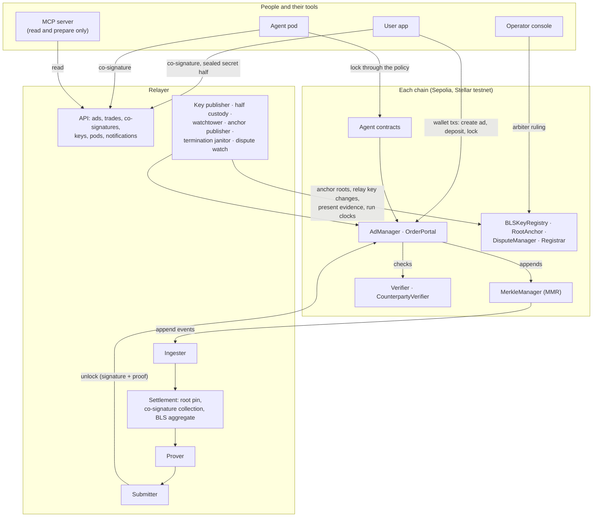
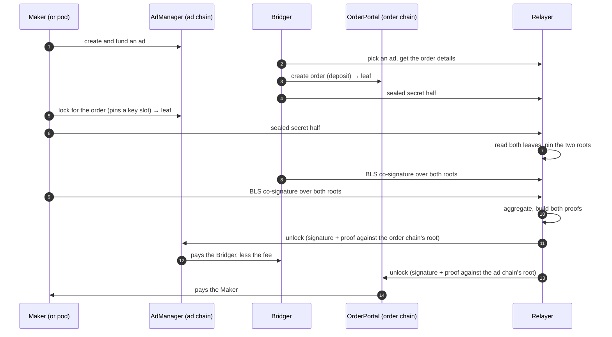

This page describes ProofBridge as it is built and running on testnet
today.

In plain terms: a Maker's liquidity sits in an escrow on one chain (the
**ad chain**) and a Bridger's deposit sits in an escrow on the other (the
**order chain**). Each escrow records a leaf in its own chain's
[Merkle Mountain Range](/v3/concepts/merkle-mountain-range) when it takes
funds. To release funds, both parties sign the two chains' roots, and a
zero-knowledge proof shows the other side's leaf is in the other chain's
tree.

The relayer does the legwork between those steps. It holds no user funds,
only its own gas, and has no authority over the escrows: signatures and
proofs gate every payout.

## System overview

## The apps

| App | What it does |
| --- | --- |
| **User app** | Connects EVM and Stellar wallets. Bridging, creating and managing ads, tracking orders, settlement keys, agents and pods, and the test-token faucet. Settlement keys are BLS keys derived and kept in the browser. Its public **Network** page shows settlement stats, route health and how fresh each chain's anchored root is. |
| **Operator console** | The arbiter panel, where an arbiter reads a dispute's case file and signs the ruling with their own wallet, plus the feedback inbox and activity views. |
| **MCP server** | Lets an AI assistant read an account's ads, trades and pods through the relayer API. It holds no key and can only prepare a message for the user to sign. See [Connect a tool](/v3/guides/connect-a-tool). |
| **Public dashboard** | Network stats at dashboard.pfbridge.xyz, read from the relayer's public stats endpoint. It lives in its own repo, `proofbridge-dashboard`. |

## The contracts

Both chains run the same contracts: Solidity on Ethereum, Soroban on
Stellar.

| Contract | Role |
| --- | --- |
| `AdManager` | The Maker's escrow. Holds ad liquidity, locks it for an order, pays the Bridger on unlock. It is the **primary** for how a trade ends: cancels and dispute rulings are decided here. |
| `OrderPortal` | The Bridger's escrow. Takes the deposit, pays the Maker on unlock, and otherwise **follows** the primary by proof. |
| `MerkleManager` | The chain's MMR. Each escrow event the other chain needs becomes a leaf. |
| `Verifier` | Checks the zero-knowledge proof. On Ethereum the verification key is built into the contract; on Stellar it's passed in as data. |
| `CounterpartyVerifier` | Checks both parties' combined BLS signature over the settlement message, against the keys in the registry. |
| `BLSKeyRegistry` | Up to five settlement key slots per account. Changes are authorised by the owner's wallet signature plus a proof of possession, so anyone can relay them. |
| `RootAnchor` | Records the other chain's Merkle roots, after a delay. Used for cancels, forfeits and disputes; a normal settlement never reads it. |
| `DisputeManager` | The dispute record, the bond, the arbiter's ruling and the clock. It never moves escrow funds. |
| `Registrar` | Key registration by proof from an account's home chain. Deployed, not switched on yet. |
| `ProofBridgeCustodyAccount`, `ProofBridgeAgentPolicy`, `CustodyAccountFactory` (Ethereum) | The per-Maker account that owns the ad, and the agent policy as an ERC-7579 validator and hook. |
| `AgentAccount` (Stellar) | The Maker's Soroban custom account; its `__check_auth` enforces the agent policy. |
| `wNativeToken` (Ethereum) | Wraps ETH so the escrows handle one token shape. On Stellar, XLM, classic assets and Soroban tokens are handled directly. |

Addresses and the supporting deployments are in
[Smart contracts](/v3/reference/smart-contracts).

### Settings worth knowing

- **Fee.** 0.5% per trade, set when the contracts are deployed: 0.3% to
  the Maker, 0.2% to the protocol. See [Fees](/v3/concepts/fees).
- **Dispute bond.** Set per route (trading pair). It can be in the route's
  own token; by default it's a flat amount in the chain's wrapped native
  token.
- **Admin delay.** A 24-hour delay on admin changes is built into the
  contracts, but it isn't switched on yet. It will be switched on before
  mainnet.

## The relayer

The relayer coordinates; the contracts decide. It runs an API and a
background worker. A normal settlement goes through six steps:

1. **Ingester.** Reads each chain's MMR append events, and marks them
   final once they're deep enough. It replays them into its own copy of
   each tree and checks every root against the one the chain emitted.
2. **Root pin.** Fixes the pair of roots (one per chain) that a trade's
   two parties will sign, so a new leaf landing in between can't split
   them.
3. **Co-signature collection.** Each party posts a BLS signature over one
   settlement message. The relayer checks the signer is a party to the
   trade. It never signs for anyone. See [Co-signing](/v3/concepts/co-signing).
4. **Aggregate.** Verifies both signatures and combines them into one.
5. **Prove.** Builds one [deposit proof](/v3/concepts/deposit-proofs) per
   payout. Both proofs are stored before either is released, so once one
   payout lands the other can always follow.
6. **Submit.** Sends the payout on both chains, paying gas only. Anyone
   holding the same signature and proofs could send the same calls.

Around the pipeline:

| Service | What it does |
| --- | --- |
| Key publisher | Relays owner-signed key registrations and changes to each chain's registry, so users don't pay gas. Holds each key's pre-signed retirement for use in an incident. |
| Half custody | Stores each party's half of the [trade secret](/v3/concepts/trade-secrets) sealed, and opens a half only inside the proof worker. |
| Watchtower | Checks stored records and trades against both chains, raises alarms, re-submits a payout pair that stalled, and cross-checks every anchored root. |
| Anchor publisher | Publishes each chain's latest final root to the other chain's `RootAnchor`. See [Root anchors](/v3/concepts/root-anchors). |
| Termination janitor | Runs the clocks: claims and finalises cancels, presents evidence of settlement, refunds the order chain, finalises disputes. Every call it makes is one anyone could make. |
| Dispute watch | On a new dispute, checks the other chain at once and presents evidence if the trade settled; otherwise builds the arbiter's case file. |
| Pods | Records pods, their keys and policies, and runs hosted-pod requests. |
| Notifications | In-app, web push and email reminders for trades that need action. |

## Agents and pods

An [agent](/v3/concepts/agents) trades for one Maker. It screens an
incoming order, locks it, and co-signs the settlement. Screening checks
the order against a copy of the Maker's on-chain policy; it can only
refuse a trade, never force one.

The policy that binds the agent is on-chain:

| Setting | What it limits |
| --- | --- |
| Allowed action | what the agent may do. Today that's one thing: lock orders. |
| Tokens | a whitelist of tokens it may lock |
| Per-order cap | the most it may lock for one order |
| Volume cap | a total that refills continuously over time, not a daily window |
| Expiry | when the policy ends |
| Revoke | instant and permanent |

An ad can also have an optional **guard rail**. Tightening it is instant;
loosening it, and large withdrawals, wait a delay first.

How each chain enforces it:

- **Ethereum.** The Maker's `ProofBridgeCustodyAccount` owns the ad. The
  agent locks through `executeAsAgent`, which `ProofBridgeAgentPolicy`
  checks first. The policy is an ERC-7579 validator and hook, so it can
  also be installed on other ERC-7579 accounts, such as Kernel or an
  EIP-7702 wallet; live pods use the custody account.
- **Stellar.** The Maker's `AgentAccount` owns the ad, and its
  `__check_auth` applies the same rules.

Either way, the account never holds the Maker's funds: they go from the
wallet straight into the escrow.

A running agent is a **pod**, self-hosted or [hosted](/v3/guides/hosted-pods).
Its settlement key sits in one of the Maker's five registry slots, and
each lock on the ad chain pins the slot it was locked with. If a pod is
removed while it has open trades, the Maker can re-pin each trade to
another slot with their consent, and the trade then settles normally.

## A normal trade

Each payout checks the combined signature, the proof and a one-time
nullifier before it releases funds. The payout on the ad chain must land
before the cancel window would close, less a safety margin, so a cancel
and a payout can never both succeed. The step-by-step version is in
[How it works](/v3/how-it-works).

## When a trade doesn't settle

The ad chain decides how the trade ends; the order chain follows by
proof, once the ad chain's root is anchored on it.

- **Cancel.** After the deadline, anyone can claim a cancel. That opens a
  short window; if nothing settles the trade in it, `finalizeCancel`
  returns the lock to the ad. The order chain then refunds the Bridger by
  proof. See [Cancels and refunds](/v3/concepts/cancels-and-refunds).
- **Dispute.** Either party can file on the ad chain, with a bond. There
  are four outcomes. The arbiter is a separate role and can't rule that
  the trade settles; only evidence can. A ruling opens a window in which
  proof of settlement still wins. With no ruling, the result is a mutual
  refund. A Maker forfeit pays the Bridger the Maker's locked amount less
  the fee, and refunds the deposit. See [Disputes](/v3/concepts/disputes).
- **Clocks.** How the deadline and the windows fit together is in
  [Deadlines and clocks](/v3/concepts/deadlines-and-clocks).
- **Anchors.** How one chain learns the other's root without a
  co-signature is in [Root anchors](/v3/concepts/root-anchors).

Evidence beats clocks: if one side has already settled, presenting that
proof finishes the trade on the other side.

## Further reading

- [Smart contracts](/v3/reference/smart-contracts): every contract and its addresses
- [Settlement keys](/v3/concepts/settlement-keys): key slots, retiring and replacing
- [Supported networks](/v3/concepts/supported-networks)
